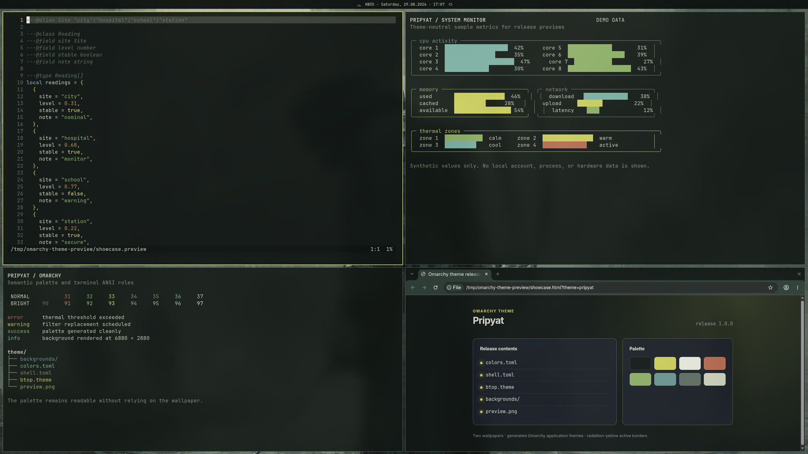
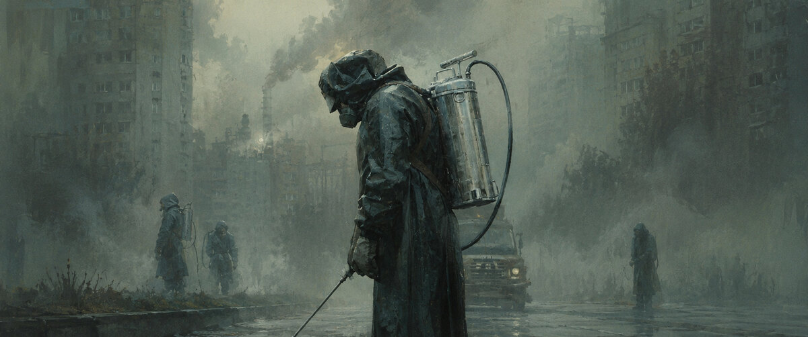
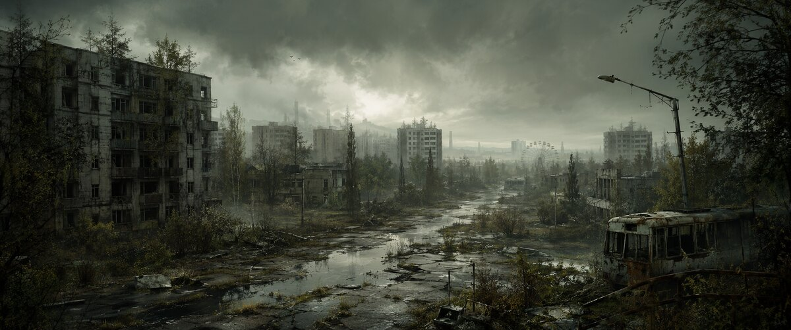

# Pripyat for Omarchy

Pripyat is a dark Omarchy theme built around Chernobyl cleanup imagery and the abandoned city. Soot-black green surfaces follow the protective suits and ruined buildings. Concrete haze supplies the text ramp, oxidized steel supplies cool accents, and radiation yellow marks focus and warnings.



## Wallpapers

### Cleanup workers (default)



### Abandoned city alternate



## Install

```bash
omarchy theme install https://github.com/nibra180/omarchy-pripyat-theme
```

Reapply it later with:

```bash
omarchy theme set pripyat
```

## Included

- `colors.toml` defines the complete Omarchy semantic and ANSI palette.
- `shell.toml` applies the palette to the bar, launcher, menus, notifications, lock screen, and controls.
- `btop.theme`, `chromium.theme`, and `icons.theme` cover app-specific details.
- `backgrounds/` contains two 6880x2880 wallpapers; the cleanup workers image is the default.
- `assets/` contains README-sized wallpaper previews.
- `preview.png` is an anonymous 1800x1012 desktop capture showing the theme across Neovim, terminal, system-monitor, and Chromium windows.
- `DESIGN.md` records the palette sources, usage rules, and release checklist.
- `ASSETS.md` records artwork authorship and attribution requirements.

Omarchy generates terminal, Hyprland, editor, Pi, Obsidian, keyboard, and VS Code files from `colors.toml`. The theme contains no custom executable configuration.

## Artwork and affiliation

The wallpapers were created by nibra180 using ChatGPT. The README-sized images and gallery preview were derived from that artwork by nibra180. Pripyat treats the Chernobyl catastrophe and cleanup workers as historical subjects and is not affiliated with or endorsed by OpenAI or any institution associated with Chernobyl. See [ASSETS.md](ASSETS.md) for attribution details.

## License

Theme configuration and documentation are licensed under the [MIT License](LICENSE). The wallpapers and previews are licensed under [CC BY 4.0](LICENSES/CC-BY-4.0.txt).
